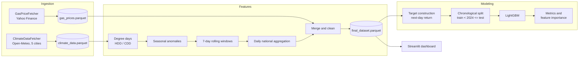

# Weather-Driven Signal Research for Henry Hub Natural Gas

### A reproducible pipeline that tests whether temperature stress (HDD/CDD) and its anomalies contain out-of-sample predictive information about next-day natural gas returns.


[Summary](#summary) · [Motivation](#motivation) · [Methodology](#methodology) · [Architecture](#architecture) · [Evaluation](#evaluation-protocol) · [**Limitations**](#known-limitations-and-threats-to-validity) · [Installation](#installation) · [Roadmap](#roadmap)

---

## Summary

| | |
|---|---|
| **What it is** | An end-to-end research pipeline: data ingestion, feature engineering, chronological model evaluation, and a read-only dashboard. |
| **Hypothesis** | Weather is the dominant short-horizon driver of U.S. natural gas demand. Heating and cooling degree days, and their deviation from seasonal norms, should therefore carry information about subsequent price moves. |
| **Target** | Next-day percentage return of the front-month Henry Hub futures contract (`NG=F`). |
| **Model** | LightGBM gradient-boosted trees (regression), evaluated on a strictly chronological hold-out. |
| **Primary metrics** | Directional accuracy, MAE, RMSE, and gain-based feature importance. |
| **Stance on results** | Daily returns of liquid futures are close to unpredictable. A directional accuracy near 50% is the expected null result, and this repository reports it as such. The value of the project is in the methodology and in an honest account of what the evidence can and cannot support. |
| **Reproducibility** | A single command (`python main.py`) rebuilds every artifact from public data sources. No API keys are required. |

---

## Motivation

Natural gas is one of the few liquid commodities whose fundamentals are tightly coupled to a single observable physical variable: temperature. Residential and commercial heating load in winter and power-sector cooling load in summer move demand in ways that are partially forecastable days in advance, yet futures prices respond to the *surprise* relative to seasonal expectations rather than to temperature levels themselves.

This project operationalises that idea in the simplest defensible form:

1. Convert raw temperature into demand-relevant quantities (degree days).
2. Express them as deviations from seasonal norms (anomalies).
3. Aggregate across the main consumption regions.
4. Test, without look-ahead, whether the resulting features improve next-day return prediction.

---

## Methodology

### Data

| Source | Content | Access |
|---|---|---|
| Yahoo Finance (`yfinance`) | Daily OHLCV for `NG=F`, from 2015-01-01 | Public, no key |
| Open-Meteo Archive API | Daily min/max/mean temperature, snowfall, precipitation | Public, no key |

Weather is sampled at five locations chosen to proxy the principal regions of gas consumption: New York (Northeast), Chicago (Midwest), Houston (South), Los Angeles (West) and Denver (Rockies). Temperatures are converted from Celsius to Fahrenheit.

### Feature engineering

| Feature | Definition |
|---|---|
| `hdd` / `cdd` | `max(0, 65 - T_mean)` and `max(0, T_mean - 65)`, base 65 F, per city per day |
| `hdd_anomaly` | City HDD minus the historical mean HDD for the same ISO week of year. Positive values indicate colder than seasonal norm |
| `hdd_rolling_7d` | Trailing 7-day cumulative HDD per city |
| `snowfall_rolling_7d` | Trailing 7-day cumulative snowfall per city |
| `national_avg_hdd`, `national_max_hdd`, `national_avg_cdd` | Cross-city mean and maximum of daily degree days |
| `national_hdd_anomaly` | Cross-city mean of HDD anomaly |
| `national_max_hdd_7d`, `national_snowfall_7d` | Maximum cumulative HDD and total cumulative snowfall across cities |
| `volume` | Futures trading volume |

Climate features are left-joined onto trading days and forward-filled for non-trading gaps. Rows without a closing price are dropped.

### Target construction

```
target_next_day_return(t) = close(t+1) / close(t) - 1
```

Implemented as `close.pct_change().shift(-1)`, so features observed on day `t` are aligned with the return realised from `t` to `t+1`. The final row, which has no successor, is removed.

### Train/test protocol

A single chronological split is used: all observations before 2024-01-01 form the training set and all observations from 2024-01-01 onward form the test set. No shuffling or random cross-validation is applied, since either would leak future information into the training fold.

---

## Architecture



### Repository layout

```
.
├── config.py                # Central configuration: tickers, cities, dates, API endpoints
├── data_fetcher.py          # Price and weather ingestion with retry and rate-limit handling
├── feature_engineering.py   # Degree days, anomalies, rolling windows, aggregation, merge
├── modeling.py              # Target construction, training, evaluation, feature importance
├── main.py                  # Pipeline orchestrator (ingestion -> features -> model)
├── app.py                   # Streamlit dashboard (reads final_dataset.parquet)
├── requirements.txt
└── data/                    # Generated at runtime, not version controlled
```

### Design notes

- **Configuration is separated from logic.** Cities, endpoints, variables and paths live in `config.py` as immutable tuples and dataclasses.
- **Ingestion is defensive.** The weather client applies exponential back-off on HTTP 429, retries transient network errors, and skips a city rather than aborting the entire run if one location fails persistently.
- **Stages communicate through Parquet files.** Each phase can be rerun independently, and intermediate artifacts are inspectable.

---

## Evaluation protocol

Reported on the held-out period:

| Metric | Purpose |
|---|---|
| Directional accuracy | Share of days where the sign of the prediction matches the sign of the realised return. The economically relevant metric for a long/short signal |
| MAE, RMSE | Magnitude of forecast error in return units |
| Gain-based feature importance | Which inputs the trees rely on. Exported to `data/feature_importance.png` |

Metrics are printed to the console at the end of `python main.py`. Because the data window extends to the current date, the test set grows over time and reported figures will vary between runs.

**Interpretation guidance.** Directional accuracy on a single test window should be compared against the empirical share of up-days in that window, and its deviation from that baseline tested for statistical significance (for example with a binomial test) before any claim of predictive skill is made. A figure of 50% to 52% on roughly two to three years of daily data is within sampling noise and should not be read as evidence of an edge.

---

## Known limitations and threats to validity

This section is intentionally explicit. The pipeline is a research prototype, and the following issues bound the conclusions that can be drawn from it.

| Issue | Description | Planned remedy |
|---|---|---|
| **Anomaly look-ahead** | The seasonal HDD baseline is the mean over the full sample, including the test period. Anomalies on test days therefore use information from after the prediction date | Compute the baseline with an expanding or rolling window using only data available at time `t` |
| **Early stopping on test data** | LightGBM early stopping monitors the same set used for final evaluation, which biases the reported error optimistically | Carve out a separate validation block from the end of the training period |
| **Single split** | One train/test boundary gives one noisy estimate of out-of-sample performance | Walk-forward (expanding-window) evaluation with per-fold metrics |
| **Observed, not forecast, weather** | Features use realised temperatures, whereas the market trades on weather *forecasts* issued before the fact. Realised weather is a different, partly already-priced, information set | Use archived forecast data and model the forecast revision |
| **Stale tail of weather data** | The weather request ends two days before the current date, so the most recent rows are filled forward | Truncate the dataset to the last date with real observations |
| **Continuous futures artifacts** | `NG=F` is a stitched front-month series. Contract rolls introduce jumps that can appear as spurious returns, particularly in contango | Use roll-adjusted or contract-level data |
| **Non-stationary inputs** | Raw `volume` is trending and regime-dependent | Replace with normalised volume (z-score or ratio to a trailing mean) |
| **No transaction costs or sizing** | Directional accuracy is not a P&L. Costs, slippage and position sizing are not modelled | Add a backtest layer with explicit cost assumptions |
| **Narrow feature set** | No storage (EIA), production, LNG exports or term-structure data | Integrate EIA weekly storage surprises and curve features |

---

## Installation

Requires Python 3.10 or later.

```bash
git clone https://github.com/AntonioOYM/Tst1.git
cd Tst1

python -m venv .venv
source .venv/bin/activate        # Windows: .venv\Scripts\activate
pip install -r requirements.txt
```

### Run the full pipeline

```bash
python main.py
```

This downloads data, builds features, trains the model and writes to `data/`:

| Artifact | Description |
|---|---|
| `gas_prices.parquet` | Raw OHLCV prices |
| `climate_data.parquet` | Raw daily weather for five cities |
| `final_dataset.parquet` | Merged feature table |
| `feature_importance.png` | Gain-based importance plot |

The weather client pauses between cities to respect public rate limits, so the first run takes a few minutes.

### Launch the dashboard

```bash
streamlit run app.py
```

The dashboard visualises price against national HDD and shows the most recent rows of the dataset. It requires `data/final_dataset.parquet`, which `main.py` produces.

---

## Reproducing individual stages

Each stage consumes the Parquet output of the previous one:

```python
from feature_engineering import run_feature_engineering
from modeling import run_modeling

run_feature_engineering()   # reads gas_prices.parquet + climate_data.parquet
run_modeling()              # reads final_dataset.parquet
```

---

## Roadmap

- [ ] Point-in-time seasonal baselines (remove anomaly look-ahead)
- [ ] Separate validation set; walk-forward evaluation with per-fold reporting
- [ ] Statistical significance testing of directional accuracy against the up-day base rate
- [ ] Forecast-based weather inputs and forecast-revision features
- [ ] EIA storage surprise and futures term-structure features
- [ ] Backtest layer with transaction costs and volatility-scaled sizing
- [ ] Unit tests for feature construction and target alignment
- [ ] Persist run metrics to disk and surface them in the dashboard

---

## Stack

`Python` · `pandas` · `NumPy` · `LightGBM` · `scikit-learn` · `yfinance` · `Open-Meteo` · `PyArrow / Parquet` · `Streamlit` · `Plotly` · `Matplotlib` · `loguru`

---

## Disclaimer

This repository is for educational and research purposes only. It does not constitute investment advice, and nothing herein should be interpreted as a recommendation to trade any instrument.

## Author

**Antonio** ([@AntonioOYM](https://github.com/AntonioOYM)) — Quantitative climate-finance research project.
