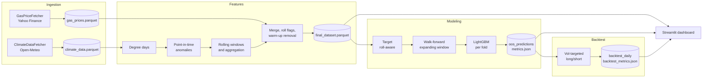

# Weather-Driven Signal Research for Henry Hub Natural Gas

### A reproducible, leakage-controlled pipeline that tests whether temperature stress and its seasonal anomalies carry out-of-sample information about next-day natural gas returns.

[](https://github.com/AntonioOYM/Natural-Gas-Price-Prediction-Weather-Driven-ML-Pipeline-Henry-Hub-/actions/workflows/ci.yml)


[Summary](#summary) · [Methodology](#methodology) · [Evaluation protocol](#evaluation-protocol) · [Backtest](#backtest) · [Architecture](#architecture) · [**Verify it yourself**](#verify-it-yourself) · [Limitations](#known-limitations-and-threats-to-validity) · [Installation](#installation) · [Roadmap](#roadmap)

---

## Summary

| | |
|---|---|
| **What it is** | An end-to-end research pipeline: ingestion, point-in-time feature engineering, walk-forward evaluation, a cost-aware backtest and a read-only dashboard. |
| **Hypothesis** | Heating and cooling degree days, and their deviation from seasonal norms, carry information about the next-day return of front-month Henry Hub futures. |
| **Target** | Next-day percentage return of the continuous front-month contract (`NG=F`), with contract-roll returns excluded. |
| **Model** | LightGBM regression, retrained every year on an expanding window. |
| **Evidence reported** | Pooled and per-fold directional accuracy against the majority-class baseline, binomial significance tests, rank information coefficient, and a volatility-targeted backtest net of slippage with per-fold Sharpe dispersion. |
| **Stance on results** | Daily returns of a liquid future are close to unpredictable, so a null result is the expected outcome. The value of the project is the methodology and an honest statement of what the evidence supports. |
| **Reproducibility** | `python main.py` rebuilds every artifact from public data. No API keys are required. |

---

## Methodology

### Data

| Source | Content | Access |
|---|---|---|
| Yahoo Finance (`yfinance`) | Daily OHLCV for `NG=F` from 2015-01-01 | Public, no key |
| Open-Meteo Archive API | Daily temperature, snowfall, precipitation for five U.S. cities | Public, no key |

Locations proxy the main consumption regions: New York (Northeast), Chicago (Midwest), Houston (South), Los Angeles (West), Denver (Rockies).

### Features

Every feature at date `t` uses only information available at or before `t`.

| Feature | Definition |
|---|---|
| `hdd`, `cdd` | `max(0, 65 - T_mean)` and `max(0, T_mean - 65)` per city (base 65 F) |
| `hdd_anomaly` | City HDD minus the mean HDD of the same ISO week **over previous years only** (expanding window, minimum 3 prior years) |
| `hdd_rolling_7d`, `snowfall_rolling_7d` | Trailing 7-day cumulative HDD and snowfall |
| `national_*` | Cross-city mean/max aggregates of the above |
| `volume_ratio_20d` | Volume divided by its trailing 20-day mean (raw volume is non-stationary) |

Prices after the last available weather observation are dropped instead of forward-filled, so no row relies on stale weather. Rows in the anomaly warm-up period are removed.

### Target and futures rolls

```
target(t) = close(t+1) / close(t) - 1
```

The continuous front-month series switches contracts at expiry, so the return that ends on the first trading day after expiry mixes two contracts and is not a tradeable return. Expiry dates are estimated from the exchange rule (three business days before the first calendar day of the delivery month, US federal holidays as calendar proxy). Returns ending within one trading day of the estimated roll are **excluded** from training, evaluation, backtest P&L and volatility estimation.

This is a heuristic. `roll_diagnostic()` in `feature_engineering.py` prints mean absolute return by offset from the estimated roll day so the assumption can be checked against the actual data.

---

## Evaluation protocol

**Expanding-window walk-forward, one calendar year per fold.**

```
fold 1:  train [..............]  embargo  test [2018]
fold 2:  train [..................]  embargo  test [2019]
fold k:  train [.......................]  embargo  test [Y]
```

- The first test year is the first year with at least three years of training history.
- A 5-trading-day embargo separates each training window from its test year.
- Early stopping uses the chronological tail (15%) of each training window, never the test year.
- Out-of-sample predictions from all folds are pooled for headline metrics; per-fold metrics give the dispersion.

| Metric | Purpose |
|---|---|
| Directional accuracy vs. naive majority | Share of days with the correct sign, compared with always predicting the more frequent direction |
| Binomial test (vs. 50% and vs. naive majority) | Whether accuracy is distinguishable from chance. The naive-majority test is the conservative one |
| Rank information coefficient (Spearman) | Rank correlation between prediction and realised return, insensitive to scale |
| MAE vs. zero-forecast MAE | Whether the model beats predicting no move |
| Fold mean and standard deviation | Stability of the result across regimes |

Outputs are written to `data/metrics.json`, `data/fold_metrics.csv`, `data/oos_predictions.parquet` and `data/feature_importance.csv`.

---

## Backtest

A long/short strategy trades the sign of each out-of-sample prediction.

| Component | Specification |
|---|---|
| Timing | Prediction at close of `t` sets the position held from `t` to `t+1` |
| Sizing | Volatility targeting: 15% annualised target, 20-day trailing volatility, leverage capped at 2x |
| Costs | 1.5 ticks of slippage (tick = 0.001 USD/MMBtu) per unit of turnover, relative to price |
| Benchmark | Always-long position with identical sizing |
| Reported | Gross and net Sharpe, approximate Sharpe standard error, max drawdown, turnover, per-fold net Sharpe (mean and std) |

Commissions, financing, margin and market impact are not modelled. All parameters live in `ResearchConfig` in `config.py`.

---

## Architecture



```
.
├── config.py                  # Data, climate and research parameters
├── data_fetcher.py            # Price and weather ingestion with retry/back-off
├── feature_engineering.py     # Degree days, point-in-time anomalies, roll flags, merge
├── modeling.py                # Target, walk-forward splits, LightGBM, metrics, significance
├── backtest.py                # Volatility-targeted long/short with slippage
├── main.py                    # Pipeline orchestrator
├── app.py                     # Streamlit dashboard (reads artifacts only)
├── tests/                     # pytest suite (unit, causality and end-to-end smoke tests)
├── .github/workflows/ci.yml   # ruff + pytest on every push and pull request
├── pyproject.toml             # ruff and pytest configuration
├── requirements.txt
├── requirements-dev.txt
└── data/                      # Generated at runtime, not version controlled
```

---

## Verify it yourself

Claims in this README map to checks in the repository.

| Claim | How to check |
|---|---|
| Anomalies are point-in-time | `tests/test_features.py::test_anomaly_is_point_in_time` changes or deletes all future data and asserts that past anomalies are unchanged. A full-sample baseline fails this test |
| Target is aligned without look-ahead | `tests/test_modeling.py` checks the shift on known prices and that roll-crossing returns are dropped |
| Walk-forward never trains on the future | `test_walk_forward_splits_are_chronological_and_embargoed` asserts train < embargo < test for every fold and non-overlapping, expanding windows |
| The evaluation can detect a real signal | `test_walk_forward_recovers_a_planted_signal_out_of_sample` plants a known signal and expects the pipeline to find it |
| The evaluation does not invent a signal | `test_walk_forward_finds_no_edge_in_pure_noise` expects roughly 50% accuracy on noise |
| Backtest sizing uses only past data | `test_trailing_volatility_uses_only_past_returns` and the timing test on `position * y_true` |
| The whole pipeline runs | `tests/test_pipeline_smoke.py` runs features, modeling and backtest end to end on synthetic data |

```bash
pip install -r requirements-dev.txt
pytest -q
ruff check . && ruff format --check .
```

---

## Known limitations and threats to validity

| Issue | Status |
|---|---|
| Anomaly look-ahead | **Fixed.** Seasonal baseline uses previous years only |
| Early stopping on test data | **Fixed.** Early stopping uses a validation tail of the training window |
| Single train/test split | **Fixed.** Expanding-window walk-forward with per-fold dispersion |
| Stale weather forward-filled at the tail | **Fixed.** Rows after the last weather date are dropped |
| Non-stationary raw volume | **Fixed.** Replaced by volume relative to its trailing mean |
| Contract-roll artefacts | **Mitigated.** Roll-affected returns are excluded. The roll calendar is an estimate (see `roll_diagnostic()`), and the series is still unadjusted otherwise |
| Realised, not forecast, weather | **Open.** Markets trade on forecasts. Open-Meteo's Previous Runs API (lead-time offsets of 1 to 7 days) would allow forecast-revision features, but it only covers January 2024 onward, so such a study would have a short sample |
| No storage or fundamentals data | **Open.** EIA storage requires publication-lag handling (Thursday release for the week ending the previous Friday) |
| Slippage only | **Open.** No commissions, financing or market impact |
| Multiple testing | **Open.** Few hypotheses were tried, but no formal correction is applied |
| Open-source data quality | **Open.** Yahoo Finance continuous futures are not a substitute for exchange or vendor data |

---

## Installation

Requires Python 3.10 or later.

```bash
git clone https://github.com/AntonioOYM/Natural-Gas-Price-Prediction-Weather-Driven-ML-Pipeline-Henry-Hub-.git
cd Natural-Gas-Price-Prediction-Weather-Driven-ML-Pipeline-Henry-Hub-

python -m venv .venv
source .venv/bin/activate        # Windows: .venv\Scripts\activate
pip install -r requirements.txt
```

```bash
python main.py            # ingestion -> features -> walk-forward -> backtest
streamlit run app.py      # dashboard
```

`python main.py` writes to `data/`: raw parquet files, `final_dataset.parquet`, `oos_predictions.parquet`, `fold_metrics.csv`, `metrics.json`, `feature_importance.csv/png`, `backtest_daily.parquet` and `backtest_metrics.json`. The first run takes a few minutes because the weather client pauses between cities to respect public rate limits.

---

## Roadmap

- [x] Point-in-time seasonal baselines
- [x] Walk-forward evaluation with per-fold dispersion and early stopping on a validation tail
- [x] Significance testing against the majority-class baseline
- [x] Roll-aware targets, backtest and volatility estimates
- [x] Backtest with slippage and volatility targeting
- [x] Unit, causality and end-to-end tests; CI with ruff and pytest
- [ ] EIA weekly storage with publication-lag handling and a seasonal-norm surprise measure
- [ ] Forecast-revision features from Open-Meteo Previous Runs (short sample)
- [ ] Contract-level data for a true roll-adjusted series and term-structure features
- [ ] Purged cross-validation and multiple-testing correction
- [ ] Persist run metadata (data version, parameters, commit hash) alongside metrics

---

## Stack

`Python` · `pandas` · `NumPy` · `LightGBM` · `SciPy` · `yfinance` · `Open-Meteo` · `PyArrow` · `Streamlit` · `Plotly` · `pytest` · `ruff` · `GitHub Actions`

## Disclaimer

For educational and research purposes only. Nothing in this repository is investment advice.

## Author

**Antonio** ([@AntonioOYM](https://github.com/AntonioOYM))
